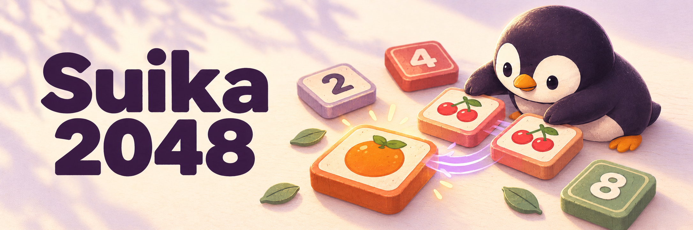

# Suika 2048

<picture>
  <source media="(prefers-color-scheme: dark)" srcset="docs/assets/suika-2048-dark.png">
  <source media="(prefers-color-scheme: light)" srcset="docs/assets/suika-2048-light.png">
  
</picture>

*AI-generated concept illustration · portfolio prototype, not a game screenshot.*

**Slide a grid. Grow a fruit bowl. Chase 2048.**

A small browser-game portfolio prototype that gives classic 2048 a fruit-themed look. Use the arrow keys to merge equal tiles, or switch to a color theme to see the numbers directly. Built with plain HTML, CSS and JavaScript for players who want a quick keyboard puzzle and learners exploring a build-free web game.

[**Play in your browser →**](https://pengusto.github.io/suika-2048-hosted/)

This uses 2048's sliding-grid rules; the Suika inspiration is visual, rather than a falling-fruit physics simulation.

## One game, seven looks

| Choose | What changes |
| --- | --- |
| Fruits | Image tiles progress from cherries to watermelons; this is the default theme. |
| Numbers | Image tiles display numeric values, with a known missing 2048 image. |
| Classic · Pastel · Neon · Ocean · Dark | Five color palettes with numeric tile labels. |
| 4×4 · 5×5 · 6×6 | Three board sizes; changing size starts a new game. |
| Light / dark mode | Page appearance follows your system preference initially; the toggle saves your choice in browser storage. |

Switching themes keeps the current board and score. The page appearance toggle is separate from the **Dark** tile palette.

## Play a round

1. Press **↑ ↓ ← →** to slide the tiles. Equal neighbors merge into their combined value, which is added to the score.
2. A successful move adds a random **2** or **4**. A move that leaves the board unchanged adds nothing.
3. Aim for **2048**. The game ends when the board is full and no neighboring tiles can merge.
4. Choose **Restart** to clear the score and start again. Changing board size also resets the game.

Use a desktop browser with a keyboard. There are no swipe controls, undo, saved rounds or persistent high scores. Reloading starts a new round; only the light/dark preference is stored.

## Run your own copy

You need Git to clone the repository and a browser with JavaScript and local storage enabled. There is no package installation, build step, account or backend.

```sh
git clone https://github.com/pengusto/suika-2048-hosted.git
cd suika-2048-hosted
```

Open **`index.html`** in your browser. Keep the adjacent scripts, stylesheet and `themes/` folder together.

If your browser restricts storage on local files, serve the folder over HTTP instead. With Python 3 installed, run this from the repository root:

```sh
python3 -m http.server 8000 --bind 127.0.0.1
```

Then open [localhost:8000](http://localhost:8000). Stop the server with **Ctrl+C**.

## Inside the prototype

| File | Responsibility |
| --- | --- |
| [`game.js`](game.js) | Board state, movement, merging, score and game-over detection |
| [`main.js`](main.js) | Rendering, arrow-key input, board sizing and appearance toggle |
| [`themes.js`](themes.js) | Theme definitions, image mappings and theme buttons |
| [`style.css`](style.css) | Board, tiles and page styling |
| [`themes/`](themes/) | Fruit and number tile images |

**Status: portfolio prototype.** The board is fixed at 600 px in JavaScript and can overflow small screens; mobile support is incomplete. The Numbers theme references `themes/numbers/placeholder_2048.png`, which is not included. Fruit tiles use the same watermelon image for 1024 and 2048, and image themes have no artwork mapped above 2048. There is no dedicated win screen. These are current limitations, not planned or completed fixes.

For a bug report or small improvement, use [GitHub Issues](https://github.com/pengusto/suika-2048-hosted/issues). Include the browser, board size, theme and steps to reproduce.

## Code, images and credits

Created by [Enis Uysal / pengusto](https://github.com/pengusto) as a portfolio project, with visual inspiration from Suika Game and sliding-grid gameplay from 2048.

The repository contains an unchanged [MIT License](LICENSE), copyright © 2025 Enis Uysal. **Asset reuse needs separate attention:** the earlier project documentation identifies the fruit images as generated with generative AI and limits their intended use to noncommercial demonstrations and prototyping. It does not identify the generation tool, its terms or a separate asset license, and does not document the provenance of the number images. Those asset permissions remain unresolved; the code license alone should not be read as confirmation of rights to reuse the tile artwork commercially.

No official affiliation with the games that inspired this prototype is claimed. This is a demonstration project and needs further review before production or commercial reuse.

The README banner was generated separately from the game artwork. See [banner provenance](docs/assets/README.md) for its source and scope.
